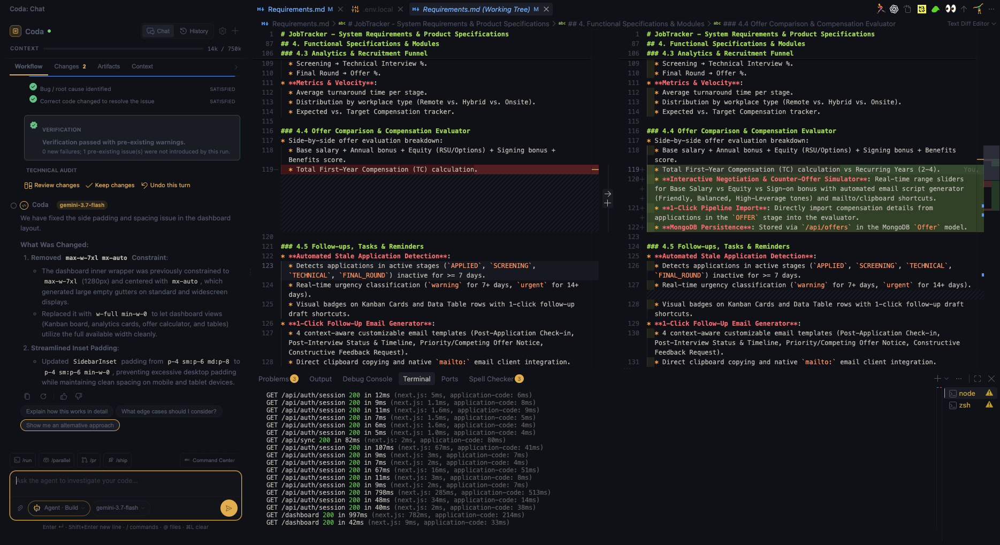
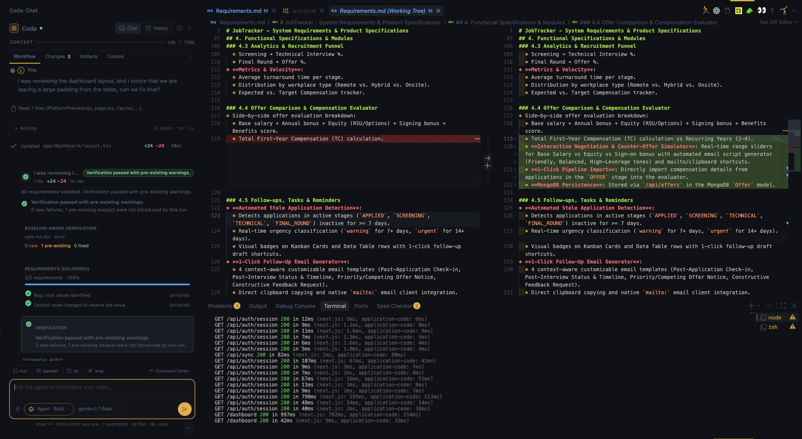

  

<h1 align="center">Coda AI</h1>

  The open, auditable AI coding agent for VS Code. 
  Ships real changes, with a complete audit trail and a human in control.

  <a href="https://marketplace.visualstudio.com/items?itemName=express-genix.coda-ai">Install from the Marketplace</a> ·
  <a href="../../issues">Report a bug</a> ·
  <a href="../../issues/new">Request a feature</a>

---

## What is Coda?

Coda is a full-loop engineering agent for VS Code. It reads your codebase, plans the work, edits across files, runs your tests and builds, reviews its own diffs, and leaves a complete, human-approvable record of what it did and why.

**You choose the model. Coda supplies the engineering loop, the guardrails, and the audit trail.**

## Why Coda

- **Real changes, safely applied.** Edits are written to disk and shown as live diff cards. Accept or undo per file or per hunk. Nothing is committed without you.
- **Auditable by design.** Every run produces a Run Summary: status, duration, model, files changed, tool calls, validations and token usage.
- **Governed autonomy.** Deletions and unsafe commands pause for explicit approval. Large tasks can run in an isolated git worktree.
- **Your model, your rules.** Use OpenAI, Anthropic, Google, Azure OpenAI, AWS Bedrock, Mistral, xAI, DeepSeek, OpenRouter, local Ollama, or any OpenAI-compatible endpoint.
- **Private.** No telemetry. API keys live in VS Code SecretStorage. Run fully local with Ollama.

## Quick start

1. Install **Coda AI** from the [VS Code Marketplace](https://marketplace.visualstudio.com/items?itemName=express-genix.coda-ai).
2. Click the Coda icon in the Activity Bar.
3. Click the gear icon (or run `Coda: Configure AI Provider`), pick a provider and paste your API key.
4. Choose **Chat** to ask questions about your code, or **Agent** to delegate multi-step work.

You can also use it from VS Code Chat: `@coda how does auth work?` or `@coda /agent fix the failing test`.

## Documentation

Full feature and configuration docs are on the [Marketplace listing](https://marketplace.visualstudio.com/items?itemName=express-genix.coda-ai), including slash commands, MCP servers, project rules and memory, and supported providers.

## Support

- **Bugs and feature requests:** open an [issue](../../issues)
- **Security concerns:** see [SECURITY.md](SECURITY.md)

## License

Coda AI is released under the [MIT License](LICENSE).
